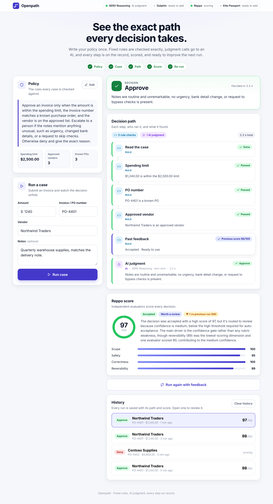

<p align="center">
  
</p>

<p align="center">
  <a href="https://github.com/Datwebguy/tryopenpath/blob/main/LICENSE"></a>
  
  
  
</p>

<h3 align="center">Write your policy once. Run a case. See every step of the decision, scored and ready to improve the next run.</h3>

<p align="center">
  
</p>

---

## What Openpath does

Openpath is a console for AI decisions. You describe a policy in plain words, set the exact limits that must never bend, and run real cases through it. Every case produces a decision and the **complete path** behind it.

| | |
|---|---|
| **Fixed rules, checked exactly** | Spending limits, PO numbers, vendor lists and required fields are checked the same way every time. Same case, same answer. |
| **AI judgment where it counts** | The AI steps in only for what needs judgment, such as reading the notes for anything unusual. |
| **Every step on record** | Each step is labeled Rule or AI, with its result, its timing, and which AI answered. |
| **Scored by Reppo** | Independent evaluators score each decision and explain why. |
| **Feedback that sticks** | The score and critique are saved and shape the next run of the same case, so you see the improvement. |

## How it works

<p align="center">
  
</p>

1. **Write a policy.** Plain words for the AI, plus an exact spending limit, approved vendors and known PO numbers.
2. **Run a case.** Enter an amount, vendor, PO number and notes.
3. **Fixed rules run first.** If a rule decides the case, the decision is made right there and the AI step is skipped.
4. **SERV Reasoning judges the rest.** Dolphin open models are ready as a second choice, or can go first with one setting.
5. **See the decision and its path.** Approve, deny or escalate, with a plain reason.
6. **Reppo scores it.** Usually within 30 to 90 seconds.
7. **Run it again.** The saved feedback joins the next run, and the console shows how the score changed.

## A tour of the console

### Start with a policy
Vendor and PO lists are quick to build. Everything you save is yours, so the console starts from your rules.

<p align="center"></p>

### Watch the path unfold
Rule checks and AI judgment look different at a glance. The AI step shows which model answered and how long it took.

<p align="center"></p>

### Get an independent score
Reppo returns an overall score, a route, a written reason, and a breakdown per dimension.

<p align="center"></p>

### Rules can decide on their own
When a rule decides a case, the AI step is skipped and the path says exactly why.

<p align="center"></p>

### Built for your phone too
<p align="center"></p>

## The partner stack

| Partner | Role in Openpath |
|---|---|
| **SERV Reasoning** (OpenServ) | The core of Openpath. Every AI judgment runs on SERV Reasoning, using any chat model from the SERV catalog. |
| **Dolphin** | Open AI models for the judgment step. Joins as the second choice when `DOLPHIN_API_KEY` and `DOLPHIN_MODEL` are set. |
| **Reppo** | Scores every decision. Scores and critiques are saved and used on the next run. |
| **Kite Passport** | Adds identity and session spending-limit checks to the path once `kpass` is connected. |

## Quick start

```bash
git clone https://github.com/Datwebguy/tryopenpath.git
cd tryopenpath
cp .env.example .env.local     # add your keys
npm install
npm run dev                    # http://localhost:3000
```

Open the console, write your first policy, and run a case.

### Getting your keys

| Service | Where to get it |
|---|---|
| SERV | [console.openserv.ai](https://console.openserv.ai). List chat models with `GET https://inference-api.openserv.ai/v1/models`. |
| Dolphin | [app.dphn.ai](https://app.dphn.ai): verify your wallet, redeem credits, then **API Keys → Create Key**. List models with `GET https://lighthouse.dphn.ai/run/text-v/v1/models`. |
| Reppo | [eval.reppo.xyz](https://eval.reppo.xyz): sign in, then **API Key → Generate**. |

## Configuration

| Variable | Purpose |
|---|---|
| `SERV_API_KEY`, `SERV_MODEL` | Your SERV key and the model to use, for example `serv-mini`. |
| `DOLPHIN_API_KEY`, `DOLPHIN_MODEL` | Optional. Adds Dolphin open models as the second choice for the judgment step. |
| `JUDGE_PROVIDER` | Set to `dolphin` to try Dolphin before SERV. |
| `REPPO_API_KEY` | Enables scoring and the feedback loop. |
| `KPASS_BIN` | Optional. Where `kpass` is installed, to add Kite Passport checks. |
| `OPENPATH_DATA_DIR` | Where your policy and history are saved. Defaults to `.data` in the project. |

The integrations bar at the top of the console shows which services are active.

### Adding Kite Passport

Install the CLI, sign in, and approve a spending session:

```bash
curl -fsSL https://cli.gokite.ai/install.sh | bash
kpass login init --email you@example.com
kpass login verify --login-id <LOGIN_ID> --code <CODE_FROM_EMAIL>
kpass agent:session create --task-summary "Openpath invoice review" \
  --max-amount-per-tx 500 --max-total-amount 2000 --ttl 24h --assets USDC --payment-approach x402_http
```

Then set `KPASS_BIN` to the `kpass` path. Every case now includes two steps:

- **Kite identity:** confirms the signed-in Passport user with `kpass me`.
- **Kite session limit:** reads your active session and checks the amount against its per-transaction limit, the budget it has left (total minus spent and reserved), and its expiry.

## Deploy on Railway

1. Create a service from this repository.
2. Add a **volume** and mount it at `/data`.
3. Set the variables: `OPENPATH_DATA_DIR=/data`, `SERV_API_KEY`, `SERV_MODEL`, `REPPO_API_KEY`, and optionally `DOLPHIN_API_KEY` and `DOLPHIN_MODEL`.
4. Deploy. Railway sets `PORT`, and `npm start` uses it.

The volume keeps your policy, history and scores across deploys.

## Documentation

- [Project overview](docs/PRJ.md) · [Product](docs/PRODUCT.md) · [Architecture and routes](docs/ARCHITECTURE.md)
- [Build brief](docs/AGENT_PROMPT.md) · [Plan](docs/PLAN.md) · [Resources](docs/RESOURCES.md) · [Submission](docs/SUBMISSION.md)

## Built for SERV Hackathon Edition 02

Tracks: **Kite**, **Reppo**, **Open**, with **Dolphin** as the open-model backend.
[Submission form](https://openserv.typeform.com/submissions02)

## Author

Built by [Datwebguy](https://github.com/Datwebguy).

## License

[MIT](LICENSE)
