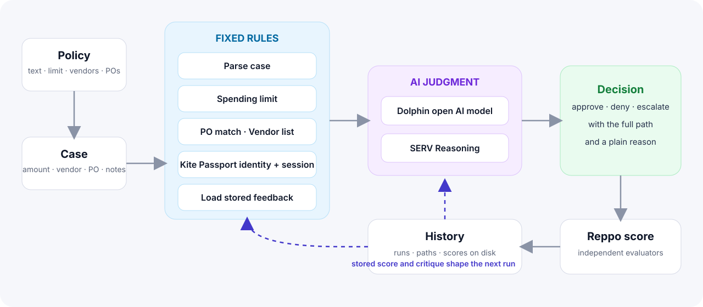

# Openpath: Architecture

## Overview
A Next.js (App Router, TypeScript) application with one flow: policy and case, hard rules, model judgment, a visible path, a Reppo score, and stored feedback.



## Frontend
- **Policy card:** plain-language text, a spending limit, and tag inputs for vendors and PO numbers.
- **Case form:** amount, invoice or PO number, vendor and notes, with suggestions from the saved lists.
- **Decision and path:** the decision, the reason, and each step labeled `code` or `model` with its result and timing.
- **Score card:** the overall Reppo score, route, reason, and per-dimension bars, with the change from the previous run.
- **History:** every saved run, openable for review.
- **Integrations bar:** which services are active.

## Server routes
| Route | Purpose |
|---|---|
| `POST /api/decide` | Validates the case, runs the checks and your rules, loads stored feedback, calls the judgment step when needed, saves the run, and returns the decision, the path and the `runId`. |
| `POST /api/evaluate` | Takes a `runId`, and submits that saved run to Reppo as an `action`. The decision always comes from the saved run, never from the request. |
| `GET /api/evaluate/:evalId` | Reads the Reppo evaluation for a run in the visitor's own workspace and saves the settled score on it. |
| `GET` / `PUT /api/policy` | Reads and saves the policy, including your rules. `DELETE` removes it. |
| `GET /api/history` | Lists saved runs. `DELETE` clears them. |
| `GET /api/runs/:id` | One saved run, used by the shared run page at `/run/:id`. |
| `POST /api/rules/compile` | Turns one plain-language rule into a structured rule with SERV Reasoning. |
| `GET /api/status` | Reports which integrations are active, as yes or no values only. |

## Steps in a path
1. `parse_case`: required fields and numbers.
2. `policy_spending_limit`: amount against your limit.
3. `po_match` and `vendor_allowlist`: against your saved lists.
4. `kite_identity` and `kite_session_limit`: added when `KPASS_BIN` is set.
5. Your own rules, one step each. A rule that matches denies the case or sends it to a person.
6. `load_feedback`: the stored Reppo score for the same case.
7. `model_judgment`: skipped when a rule already decided the case.

```json
{
  "decision": "deny",
  "reason": "Denied by rule: policy spending limit",
  "ms": 12,
  "path": [
    { "step": "parse_case", "type": "code", "result": "ok" },
    { "step": "policy_spending_limit", "type": "code", "result": "failed" },
    { "step": "model_judgment", "type": "model", "result": "skipped" }
  ]
}
```

## Judgment
`lib/judge.ts` sends every judgment to SERV Reasoning through chat completions, with a system prompt on every request. The answer is structured JSON: approve or escalate, with a reason. The path records which SERV model answered and how long it took. If SERV does not answer, the case is escalated to a person.

## Rules in your own words
`lib/compile.ts` sends one sentence to SERV Reasoning and gets back a structured rule: a list of conditions over a fixed set of fields (`amount`, `vendor`, `invoiceNumber`, `notes`, `weekday`, `earlierRuns`), an outcome (`deny` or `escalate`) and a reason. The compiler accepts the common ways a model words a rule, asks once more if an answer is incomplete, and reports what is missing when a sentence needs information Openpath does not have.

`lib/rules.ts` validates every rule against exact lists of fields and operators and evaluates it as data, never as code. The same file writes the plain-language description shown next to each rule.

## Reppo
`lib/reppo.ts` follows the Evaluation API guide at https://eval.reppo.xyz/agents.md. A decision is submitted with `taskType: "action"`, and the status moves from `QUEUED` and `PROCESSING` to `COMPLETED`. The score, route, reason and rubric scores are stored with the run.

## Kite Passport
`lib/kite.ts` runs the `kpass` CLI with `--output json --no-interactive`, because Kite publishes its Passport interface as a CLI. `kpass me` confirms identity. `kpass agent:session list --status active` (or `kpass user sessions --status active`) returns the active session with `max_amount_per_tx`, `max_total_amount`, `spent_total`, `reserved_total` and `expires_at`. The amount must fit the per-transaction limit and the budget left, and the session must not have expired. Errors arrive as JSON with a `hint`, which the path shows.

## Storage and visitors
Each visitor gets a private workspace tied to a random, HttpOnly cookie (`lib/workspace.ts`). Their `policy.json` and `history.json` live in `OPENPATH_DATA_DIR/ws/<id>/`, so no visitor can read, change or clear another's data. `OPENPATH_DATA_DIR` defaults to `.data` in the project. On Railway, mount a volume and point the variable at it.

Files are written to a temporary name and then renamed, so a crash never leaves a half-written file. Each workspace keeps its latest 100 runs.

Shared links work through a small index (`shares.json`) from a run's random id to its workspace. A shared run is read-only and does not include the internal score id.

## Protection
See [SECURITY.md](../SECURITY.md) for the full list: per-visitor workspaces, server-owned runs, input limits, rate limits, browser security headers, defenses against hostile notes, and how rules are kept as data.

## Feedback loop
```
Run a case → path + decision → Reppo score → saved with the run
        ↑                                          │
        └──── next run of the same case reads it ──┘
```
Cases are matched by vendor, PO number and amount.
